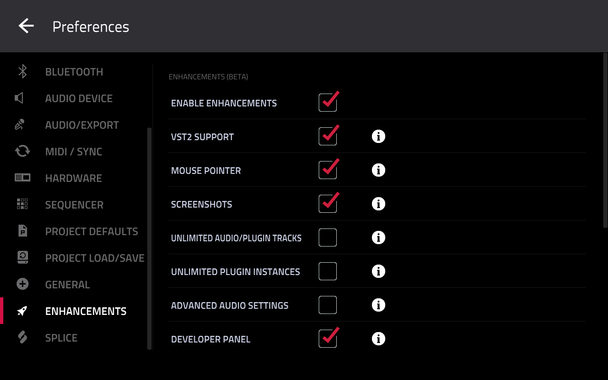
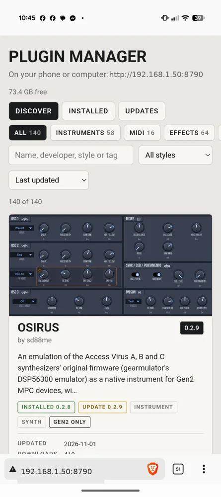

The **OpenMPC Plugin Manager** is a plugin that runs on your MPC. Once it is on a track you can browse the catalog and install, update and remove plugins, on the MPC's screen or from a web page on your phone or computer.

**To try plugins:** put the Plugin Manager on your MPC once (about five minutes), then install, try and remove any plugin in the catalog from it. Removing a plugin keeps your projects and your own files.

Answer two questions below for your steps, or open the full instructions under them. It needs MPC OS 3.x: on MPC OS 2.x, see [MPC OS 2.x](#mpc-os-2-x).

::: guide

::: folds

## MPC OS 3.10.1 or later

### 1. Turn on External Plugin Support
1. On the MPC: **Menu → Preferences → Enhancements**.
2. Tick **Enable Enhancements** and **External Plugin Support**, and accept the warning.
3. Wait a few seconds, then restart the MPC.



### 2. Download the Plugin Manager
Open [the Plugin Manager release](https://github.com/open-mpc/plugin-manager/releases/tag/plugin-manager-g2-v1.1.1) and download the zip for your MPC from **Assets**:

| Your MPC | Download |
|---|---|
| **First generation**: MPC Live, Live II, One, X, Key 61, Key 37, and the Force | `OpenMPC-Plugin-Manager-1.1.1-Gen1.zip` |
| **Second generation**: MPC Live III, One G2, Key G2, XL | `OpenMPC-Plugin-Manager-1.1.1-Gen2.zip` |

Unzip it. You get one folder, **`OpenMPC - VST - Plugin Manager`**.

### 3. Copy it to the MPC
Put the folder inside a folder called **`VST2 Plugins`** (exact name; create it if needed). Pick one way:

::: details A. Over Wi-Fi (Developer mode)
1. Turn on **Developer mode** on the MPC and note its IP address.
2. In an SFTP app (FileZilla, Cyberduck, WinSCP or a phone app), connect to that address as **`root`**, no password.
3. Copy the folder into **`VST2 Plugins`** on the internal drive: **`/nvme/VST2 Plugins/`** on a second-generation MPC, **`/sdcard/VST2 Plugins/`** on a first-generation one.
4. Restart the MPC. You can turn Developer mode off again.
:::

::: details B. With a USB cable (Controller Mode)
**MPC Live III and MPC XL:** both internal drives show on your computer, as **MPC User** (the MPC's internal drive) and **MPC Content**. On Windows they appear only once Akai's MPC USB driver is installed (from akaipro.com).

1. Connect the MPC to your computer with a USB cable.
2. **Menu**, then tap the computer icon (top right) to switch to **Controller Mode**.
3. Copy the folder into `VST2 Plugins` on the **MPC User** drive (create it if needed).
4. Eject it on the computer, tap **Standalone** on the MPC and confirm. If the Plugin Manager isn't in the plugin browser yet, restart the MPC: the internal drive is read at start-up.

**Other MPCs and the Force:** the internal drive doesn't show on a computer, only an SD card or USB drive in the MPC.

1. Put an SD card or USB drive in the MPC and connect the MPC to your computer.
2. **Menu**, then tap the computer icon (top right) to switch to **Controller Mode** (**Computer Mode** on the Force).
3. Copy the folder into `VST2 Plugins` on that card or drive.
4. Eject it on the computer, tap **Standalone** on the MPC and confirm. Leave the card or drive in.
:::

::: details C. With a USB stick or SD card
1. Copy the folder into `VST2 Plugins` on the stick or card.
2. Plug it into the MPC. No restart needed: it shows up within a few seconds. Leave it in: the plugin runs from the stick, and if you unplug it while a track uses it, the plugin stops and its screen goes black until you plug it back in.

Or let the [desktop installer app](#the-desktop-installer-app) write the stick: **MPC OS 3.10.1 → Write the Plugin Manager**.
:::

### 4. Open the Plugin Manager
1. Add a Plugin track and choose **External VST Plugins → OpenMPC → Plugin Manager**.
2. Browse and install on the MPC's screen, or open the address on its status line on your phone or computer (same Wi-Fi).


3. Pick plugins, press **Apply**. The MPC restarts once. The new plugins are under **External VST Plugins**, grouped by maker.
4. **Plugins that need your own ROM** (marked *Needs your own ROM* in the catalog): upload the ROM on the Plugin Manager's web page, under the plugin.
5. **Don't like one?** Select it in **Installed**, press **Remove**, then **Apply**.



> The web page has no password: anyone on your Wi-Fi can use it while the Plugin Manager is on a track. Remove it from the track when you are done.

Already had plugins before 3.10.1? MPC now only lists plugins in `VST2 Plugins`. In the Plugin Manager, press **Move** to bring them over; your projects keep working.

## MPC OS 3.9.1 or earlier
The easiest way is a Plugin Manager USB stick, made by the desktop installer app.

1. [Download and start the desktop installer app](#the-desktop-installer-app).
2. Choose **3.9.1 or earlier** and follow its questions to **Plugin Manager stick (one prompt)**. Pick an empty USB stick and press **Write stick…**.
3. Save your project. Put the stick in the MPC and choose **Open** on the prompt. The MPC restarts with the Plugin Manager installed.
4. Add a track and choose the **OpenMPC Plugin Manager**. Browse and install on the MPC's screen, or open the address on its status line on your phone or computer.

## MPC OS 2.x
The Plugin Manager and its USB stick are for **MPC OS 3.x**, and the stick refuses a 2.x MPC. On 2.x you install plugins over SSH (root SSH access to the MPC):

1. In the [catalog](index.html), pick plugins whose card says **MPC OS: 2.x and 3.x**. Plugins made only for 3.x don't show their screen on 2.x.
2. Install them with the [desktop installer app](#the-desktop-installer-app) over Wi-Fi: choose **2.x**, then **Connect** with the MPC's IP address and pick plugins. It warns you before installing a plugin made only for 3.x. No SSH yet? The installer app can make a stick that turns it on, from your own firmware file: answer **I don't have SSH yet** (not yet tested on MPC OS 2.x). Or install each one [by hand with ssh and scp](#by-hand-with-ssh-and-scp-download-copy-run) or [fully by hand](#fully-by-hand-without-the-installer-script).

Or update the MPC to MPC OS 3.x, then use the steps above.

## The desktop installer app
A small app for Windows, Mac and Linux. It can:

- make a Plugin Manager USB stick (every MPC OS);
- install the Plugin Manager and other plugins straight onto the MPC over Wi-Fi (3.10.1: with Developer mode; 3.9.1 or earlier: with root SSH);
- on 3.9.1 or earlier: remove plugins, register plugin folders, clean up settings backups and apply device patches.

**Download:** open [the installer release](https://github.com/open-mpc/mpc-vst-plugins/releases/tag/desktop-v2.0.1) and get the file for your computer from **Assets**:

| Your computer | File ending in |
|---|---|
| **Windows** | `-windows.zip` |
| **Mac** (Apple chip, 2020 on) | `-mac-apple-silicon.tar.gz` |
| **Mac** (Intel) | `-mac-intel.tar.gz` |
| **Linux** | `-linux.tar.gz` |

**Start it:** unpack it and double-click `mpc-installer`. It opens a page in your browser and asks a few questions about your MPC.

The first time, your computer warns that the app is not signed:
- **Windows:** **More info → Run anyway**.
- **Mac:** right-click the file, **Open**, then **Open** again.
- **Linux:** `chmod +x mpc-installer` if it will not start.

::: details Installing over Wi-Fi with the app (MPC OS 3.9.1 or earlier)
You need root SSH access to the MPC and its IP address (network settings, or your router).

1. **Connect:** type the IP address (and password, if you use one), press **Connect**.
2. **Choose:** tick plugins from the list. **Verified** = tested on hardware, **Listed** = passed automatic checks, **Experimental** = new or unproven.
3. **Install:** save your project, press **Install…** and confirm. MPC restarts once; your settings are backed up first.
4. **Use:** add the plugin to a track from the plugin browser.

- **Update:** tick a plugin marked **update** and install. Your projects and own files (ROMs, kits) are kept.
- **Remove:** **Remove plugins** → tick → **Remove…**. Your own files are kept.
- **Register plugin folders:** adds plugin folders MPC is missing from its list (for example after a card was out at start-up).
- **Clean up old backups:** keeps the newest settings backups (10 is plenty).
- **Install to:** pick the internal drive, an SD card or a USB drive. The internal drive is the safest.
- **Your own zips:** drop zip files into the box under the list. Plugins marked **Build it yourself** have no download: see the [Build](build.html#plugins-you-build-yourself) page.
:::

::: details Advanced: device patches (MPC OS 3.9.1 or earlier)
At the bottom of the app, step 7 (**Advanced: device patches**, collapsed) lists community patches that change the device itself, not a plugin. An example is the 16-pad drum layout for some plugins, which changes Akai's own MPC program. **This is not for most people**, and the app only looks: open the step (or press **Check the device**) and it asks the device which patches are applied. It cannot apply or undo a patch yet; each row links to a guide for running the script yourself over SSH. The same patches, with what each one changes, its backup and its script checksum, are on the [Device patches](patches.html) page.

Three patches are listed today: the 16-pad drum layout (it changes Akai's MPC program), the **drive exec patch** (it lets MPC load plugins from a drive mounted `noexec`, such as an MPC/Force's SSD, by making one folder of the drive executable; it adds a service to the device; the original was tried on one Force by its author, and this adapted version is **untested on a device so far, testers are wanted**), and the **button remap** (an LD_PRELOAD shim that turns a hardware button into other buttons, a pad or a screen tap; its author tried it on an MPC Live with Hakai and on a Force, and this installer is **untested on a device so far, testers are wanted**: it edits MPC's launcher or adds a service drop-in, remounts the root filesystem writable for a moment and restarts MPC, so keep an SSH session open and know how to run its `uninstall` before you try it). A row can also say **Installed, not active** (the patch is installed but not in effect right now, for example because a drive is not mounted, or because MPC has not loaded the remap).

A row can say **This firmware is not supported**. That is the patch refusing, on purpose: it only works on one exact build of MPC OS, checked by a checksum, and the row shows your device's checksum and what the patch supports. If an earlier install left a backup of the stock program, the patch's guide explains how to restore it first.
:::

## Troubleshooting (MPC OS 3.9.1 or earlier)

::: details A plugin disappears after a restart
MPC keeps its whole plugin list in one place: the `pluginList-arm` list in its settings file, `MPC.settings`. Every way of installing plugins edits that same list, so one method can undo another. The plugin's files usually are still on the card; only its line in the list is gone. The usual causes:

- **The settings file was edited while MPC was running.** MPC holds its settings in memory while it runs and saves them itself, so a change made underneath it can be overwritten. Stop MPC first (`systemctl stop acvs`; if `systemctl cat acvs` finds no such service, as on some MPC OS 2.x versions and on Hakai-enabled systems, the service is `inmusic-mpc`), edit, then start it (`systemctl start acvs`). The app and the installers do this for you.
- **Another tool rebuilt the whole list.** Some community installers and scan scripts do not add one line: they write a new list from the plugin folders they find in the `Synths` folders (each folder with a `plugin-meta.xml` inside). A plugin that is not such a folder, for example one added by hand or installed by an older release with its `.so` in `/sdcard/vst`, drops off the list at the next scan. A release is such a folder if its zip has a `portable/` folder inside, and a scan keeps it. Reinstall anything older with a release that has one.
- **The settings file became invalid.** After a broken edit MPC resets `MPC.settings` to its defaults, which empties the plugin list along with your other preferences. Restore a backup (below).
- **The line points to a file that is not there**: a plugin folder was moved or renamed, or the card it is on is not inserted.

Check what MPC has registered, and whether each file exists (on the device, over SSH):

```
grep -o 'file="[^"]*"' /media/az01-internal/Settings/*/MPC.settings | cut -d'"' -f2 |
    while read -r f; do [ -f "$f" ] && echo "ok       $f" || echo "MISSING  $f"; done
```

To get plugins back:
- **Register the plugin folders** in the app (step 5, "Register plugin folders"). If the plugin's folder is still on the device or its card, this adds its line back to the list without reinstalling anything. This is the quickest fix, and the right one when a card was out when MPC started.
- **Install the plugin again** (the current release) with the app. It adds its own line back and leaves every other plugin's line alone. This is the safest fix.
- **Or restore a backup of the settings file.** The app and the installers leave one next to the original each time they change it, named `MPC.settings.bak-<plugin>-<date>` (or `bak-remove-…`, `bak-sync-…`). List them newest first with `ls -t /media/az01-internal/Settings/*/MPC.settings.bak-*`, then stop MPC, copy the one you want over `MPC.settings`, and start MPC. A backup also brings back the preferences you had at that time.

Before you paste a command you found online into the device's shell, copy the settings file to your computer: `scp "root@<device-ip>:/media/az01-internal/Settings/*/MPC.settings" .` Any command that rebuilds, restores or resets that file replaces your whole plugin list.
:::

::: details Something else went wrong
- **The app cannot connect.** Check the IP address (it can change), that the device is on and on the same network, and that SSH is enabled. If you use a password, check it; otherwise the app only tries an SSH key in `~/.ssh` that has no passphrase.
- **The app says it cannot install on this device.** It only installs to a 32-bit ARM MPC OS device where you are logged in as root.
- **MPC shows default settings after the restart.** The edited settings file was not accepted. Restore the backup the installer made, next to `MPC.settings` (see above).
- **The plugin is not in the list.** MPC reads its plugin list at startup. Check that the app's log ended with "Done", then see "If a plugin disappears after a restart" above.
- **My drive is "noexec" and the app will not install there.** Linux lets each drive be mounted with or without permission to run programs. MPC mounts external drives (SSD, SD card, USB stick) without it, and a plugin is a program, so MPC lists it but cannot load it. This is a device rule, not an app bug. Pick one:
  1. **Install on the internal drive** (simplest, nothing on the device changes). In the app choose the internal drive under **Install to**; if it has no `Synths` folder yet the app creates it. If you only see the external drive, reconnect, or create a `Synths` folder at the top of the internal drive by hand.
  2. **Keep the plugins on the external drive** with the Auto exec patch (step 7, Advanced): it makes the `Synths` folder of every noexec drive executable, with no setup. It runs on 32-bit (Gen1) devices. After it is applied, run "Register plugin folders" (step 5) and restart MPC. If it still shows only "Load Plugin": the plugins may be in a different folder than `<drive>/Synths`, or MPC started before the drive was ready (restart MPC with the drive in).
- **The plugin is in the list but only "Load Plugin" shows.** MPC could not load the library. Two usual causes: the plugin sits on a drive mounted `noexec` (an MPC/Force's SSD is; check with `mount | grep noexec`, and install to the internal drive or an SD card instead, or, if you are comfortable with SSH, the optional **drive exec patch** listed in the app's "Advanced: device patches" step, which makes one folder of the drive executable: it is untested on a device so far, read its guide first, it adds a small service to the device), or it is a build that needs a newer glibc than your MPC OS has (a copy installed by hand, or a version older than the catalog's current one). Install the newest version from the app. If it still fails, send the `journalctl -u acvs` lines (or `journalctl -u inmusic-mpc` where there is no acvs) from the moment you add the plugin to a track, plus the output of `ls -l /lib/libc.so.6`.
- **The page is empty on MPC OS 2.x.** The plugin is made for MPC OS 3.x (the app warns about this before installing it on a 2.x device): its skin is in the newer format, which MPC OS 2.x does not draw. It still plays from the Q-Links. Look for a release marked *MPC OS 2.x tested*, or ask the plugin's developer for one.
- **The plugin loads but has no screen.** The skin goes in a `/sdcard/Synths` folder, and MPC must have that folder in its content locations. The installer warns if it does not.
- **Silence, or default sounds.** Some plugins need files you provide, such as ROMs or banks. Check the plugin's own page.

Ask in the community with the plugin's name, version, your device model and the installer's output (the log in the app).
:::

## Other ways to install (MPC OS 3.9.1 or earlier)
For people who prefer a terminal. You do not need any of these if you use the Plugin Manager or the app. They are here for people who prefer a terminal, or who cannot run the app. Each one installs the same release zips, with the same installer, so they can be mixed.

::: details One command for several plugins (no app to download)
On the [catalog](index.html), tick **Add to install list** on each plugin you want, open the bar that appears at the bottom, type your device's IP address and copy the command. Paste it into a terminal (Terminal on a Mac, PowerShell on Windows 10 or later) and press Enter. The command logs in to your device, downloads a small script (`mpc-store.sh`) from this site and runs it. The script:

- downloads every zip you picked and checks it against the checksum in the catalog, before it changes anything on the device;
- asks you to confirm, then stops MPC **once**, runs each plugin's own installer, and starts MPC again **once**;
- remembers what it installed, so `update` later installs newer versions (and holds back a change that would alter saved projects unless you add `--major`).

Prefer to read the script before running it? The bar has a "Read the script first" section with the steps and the hash the script should have. The same command with `list`, `update`, `remove <id>`, `prune` or `sync` at the end shows what is available, updates what you installed, removes a plugin (your own files in its folder are kept), deletes old backups of MPC's settings (`prune --keep 10`), or registers plugin folders you copied into `Synths` by hand. It needs the same root SSH access, and the device needs internet access. Plugins you build yourself are not included.
:::

::: details By hand with ssh and scp (download, copy, run)
**1. Download and check the zip.** Download the zip from the plugin's card on the catalog. Every version lists a checksum (SHA-256). Compare it with your download:

```
shasum -a 256 Name-1.2.0-mpc-armv7.zip      # macOS and Linux
certutil -hashfile Name-1.2.0-mpc-armv7.zip SHA256    # Windows
```

If the first characters do not match the catalog, download it again. Also open the plugin's source link and read what you are about to run as root: the installer is a plain shell script.

**2. Copy it to the device.** Unzip it, then copy the whole folder over:

```
unzip Name-1.2.0-mpc-armv7.zip
scp -r Name-1.2.0 root@<device-ip>:/tmp/
```

**3. Run the installer.** Save your project on the device first. The installer **stops MPC and starts it again**.

```
ssh root@<device-ip> sh /tmp/Name-1.2.0/install.sh
```

It checks the device, stops MPC, copies the plugin folder (the plugin, its skin and its data) into `/sdcard/Synths`, backs up `MPC.settings` next to the original, adds the plugin to MPC's plugin list and starts MPC again. Add `-y` to skip the confirmation question. If anything fails, MPC is restarted and your settings are left unchanged.

**Update:** run the new version's `install.sh` the same way. **Remove:** run `ssh root@<device-ip> sh /tmp/Name-1.2.0/uninstall.sh`; it removes the files and the plugin-list entry (after a backup), keeps your own files, and restarts MPC.
:::

::: details With Termius (click instead of type)
If you would rather click than type, use an SSH app with a file browser. [Termius](https://termius.com/) is one (macOS, Windows, Linux, iPhone, iPad and Android); other SFTP and SSH apps work the same way. You do the same two things as steps 2 and 3 of the "By hand" version, with the mouse:

1. **Add your device as a host.** In Termius, add a new host with the device's IP address and the username `root`, using the same login you would use with `ssh`. Connect once to check it works.
2. **Copy the folder over.** Unzip the plugin's zip on your computer first. Open the host's file browser (SFTP), go to `/tmp` on the device, and drag the unzipped plugin folder into it.
3. **Run the installer.** Open a terminal on the same host and type `sh /tmp/<the-folder-name>/install.sh` (Tab completes the folder name). Save your project first: it stops and restarts MPC. Answer `y` when it asks, or add `-y` to skip the question.

The app's buttons and plans change over time, so check Termius's own help if a screen looks different. It is only a nicer way to copy and run: the plugin, the checksum check and the installer are the same.
:::

::: details Fully by hand (without the installer script)
Each zip's `INSTALL.md` lists the manual steps: copy the plugin folder (`portable/<Vendor> - VST - <Name>/` in the zip) to `/sdcard/Synths/`, stop MPC (`systemctl stop acvs`), back up `MPC.settings`, add the line from that folder's `plugin-meta.xml` to the plugin list with `%payload-path%` replaced by `/sdcard/Synths`, and start MPC (`systemctl start acvs`, or `inmusic-mpc` if that is the service you stopped). Edit the settings file only while MPC is stopped (see "If a plugin disappears after a restart" above).

If you use a community tool that scans `Synths` folders for plugins, the same plugin folder works there: copy it into `Synths` and run the scan. Such a scan rebuilds the whole plugin list from the folders it finds, so it drops any plugin that is not such a folder, and it does not back up your settings first.
:::
